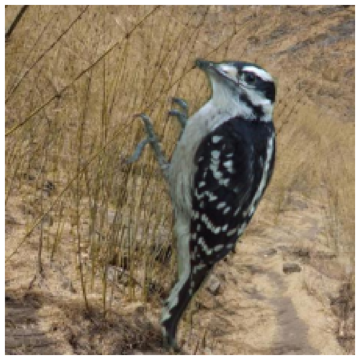

# XAI-Based Detection of Spurious Correlations in Image Classification

**Détection des corrélations fallacieuses dans les réseaux de neurones convolutifs à l'aide de l'intelligence artificielle explicable.**



A small end-to-end experiment on **Waterbirds** + **ResNet18**. The training data is
correlated: most waterbirds stand on water and most landbirds on land, so a model can
answer from the background and still score well. The experiment has four parts:

1. Train a baseline classifier.
2. Use Grad-CAM to measure how much of the explanation falls outside the bird.
3. Check whether that background reliance is associated with errors.
4. Test a targeted augmentation that uses those explanations.

The proposed augmentation did **not** work, and the negative result is reported as such.

## Dataset

Official WILDS Waterbirds v1.0 (11,788 images, official splits). CUB-200-2011 boxes are
joined by filename for the attribution metric. Images are not versioned; fetch them with:

```bash
curl -L -o data/raw/waterbirds_v1.0.tar.gz \
  https://huggingface.co/datasets/pangwei/wilds-waterbirds/resolve/main/waterbirds_v1.0.tar.gz
tar -xzf data/raw/waterbirds_v1.0.tar.gz -C data/raw/

mkdir -p data/raw/cub_annotations
BASE=https://raw.githubusercontent.com/ZF4444/MMAL-Net/master/datasets/CUB_200_2011
curl -L -o data/raw/cub_annotations/images.txt         $BASE/images.txt
curl -L -o data/raw/cub_annotations/bounding_boxes.txt $BASE/bounding_boxes.txt
```

## Run

```bash
pip install -r requirements.txt
python run_experiments.py                    # full pipeline
python run_experiments.py --steps gradcam,rq2  # single stages
```

CUDA is used when available, otherwise CPU. AMP is off by default: on the GTX 1660 an
fp16 overflow corrupted the BatchNorm statistics, and the card has no tensor cores.

## Results (GTX 1660 SUPER, seed 42)

| metric | baseline | XAI-guided |
|---|---|---|
| overall accuracy | 0.8776 | 0.8776 |
| worst-group accuracy | 0.4766 | 0.4003 |
| macro F1 | 0.8171 | 0.8090 |
| mean background ratio | 0.4355 | 0.4548 |

- Worst group: waterbird on land, 47.7%, against 87.8% overall.
- Background ratio is 0.40 for correct predictions and 0.69 for incorrect ones
  (Spearman −0.36, AUC 0.82). Association, not causation.
- The targeted augmentation kept accuracy, lowered the worst group and raised the ratio.

## Layout

```
config.py, run_experiments.py    # settings and orchestration
src/                             # dataset, model, training, evaluation, Grad-CAM, analysis
scripts/                         # rebuild slide images and the one-page summary
results/, figures/               # numbers and plots reported in the write-up
report/                          # write-up and one-page summary
notebooks/experiments.ipynb      # walkthrough of the saved results
```

## References

- Sagawa et al. (2020), *Distributionally Robust Neural Networks for Group Shifts* — dataset, groups, worst-group metric. [arXiv:1911.08731](https://arxiv.org/abs/1911.08731)
- Selvaraju et al. (2017), *Grad-CAM* — the explanation method. [arXiv:1610.02391](https://arxiv.org/abs/1610.02391)
- Xiao et al. (2021), *Noise or Signal* — background reliance on ImageNet. [arXiv:2006.09994](https://arxiv.org/abs/2006.09994)

## Notes

- Seed 42. GPU kernels are not bit-deterministic.
- Both models share data, split, architecture and schedule; only the augmentation differs.
- Bounding boxes approximate the bird, so the ratio is a proxy for background attention.
- `checkpoints/*.pth` and the dataset images are not versioned; both are regenerated by
  the commands above.
